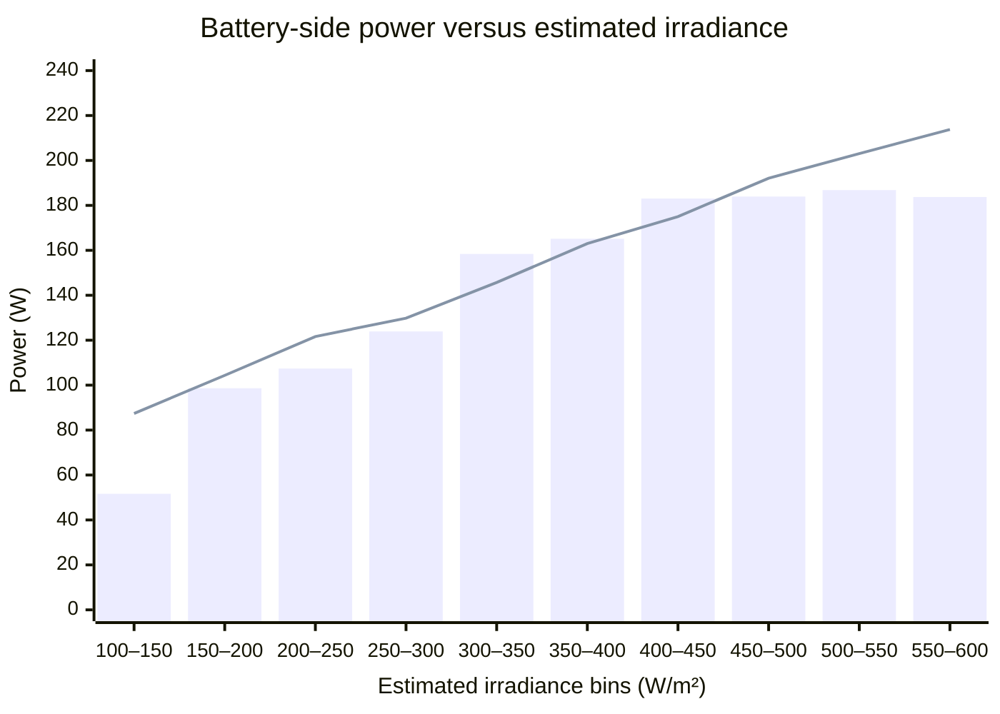

# Project HELIOS Experimental Analysis

**Tennessee Tech University · ECE Capstone Team 6 · LaniEV retrofit**

Outside testers completed the roof and battery wiring procedures with errors and questions, identifying specific changes to the installation manual. The solar roof assembly weighed 31 lb more than the removed roof. Across five comparable fixed-panel test windows, the MPPT controller delivered an estimated 648.8–851.7 Wh toward the battery. The available experimental records support a fixed-panel charging baseline and identify installation problems. Quantitative electrical acceptance, discharge performance, tracking gains, and grid independence remain open.

## 1. Installation manual validation

**Purpose and expected result.** Demonstrate that a person who did not write the manual can complete the documented steps with the correct hardware, orientation, routing, and connections. The expected outcome was independent completion with clear component identification and minimal intervention.

**Procedure.** Parker Branson documented timed use of the manual with the roof frame, gaskets, front and rear plates, panel, hardware, and kit wiring (inventory items 2–7 below). The roof trials covered frame, gasket, plate, and solar-panel hookup steps. The battery trials covered the kit wiring connections. Record elapsed time, skipped or incorrect steps, installer questions, and any mismatch with the hardware. The source identifies the roof participants as outside non-authors and the battery participants as an author and an outside non-author. Participant identities and independence across roof trials were not recorded.

| Section | Trial | Tester(s) | Time | Skipped or incorrect steps | Questions |
|---|---:|---|---:|---:|---:|
| Solar roof | 1 | Two outside non-authors | 31 min 24 s | 4 | 3 |
| Solar roof | 2 | Two outside non-authors | 30 min 59 s | 3 | 3 |
| Battery wiring | 1 | One author | 4 min 15 s | 3 | 1 |
| Battery wiring | 2 | One outside non-author | 6 min 30 s | 2 | 2 |

| Section | Trials | Mean time | Sample SD | Range | Mean errors | Mean questions |
|---|---:|---:|---:|---|---:|---:|
| Solar roof | 2 | 31 min 11.5 s | 17.7 s | 30:59–31:24 | 3.5 | 3.0 |
| Battery wiring | 2 | 5 min 22.5 s | 95.5 s | 4:15–6:30 | 2.5 | 1.5 |

The roof trials revealed ambiguity about bolt locations, PV connector polarity, gasket placement, washer placement, front-plate orientation, how the panel sits on the frame, and wire routing. The battery trials both recorded omitted connections and questions about wire identity or placement. Individual error counts are available only for the observations specifically identified below. The first roof trial reports four errors without itemizing those four errors. Every trial had errors, so a zero-error rule-of-three bound does not apply. Two trials per section and different tester types limit the conclusions about repeatability.

### Revision log

| Rev. | Trial evidence | Manual change | Status in trial record |
|---:|---|---|---|
| 1 | Roof 1, gasket placement unclear | Place panel installation before the gasket step | In progress |
| 2 | Roof 1, bolt placement unclear | Specify bolt size, count, location, and torque, and close C05 | In progress |
| 3 | Roof 1, PV connector polarity unclear | Add positive and negative labels to steps 9–10 | In progress |
| 4 | Roof 2, washers misplaced | Add a washer placement photo | In progress |
| 5 | Roof 2, front plates backward | Add an orientation note for steps 6–7 | In progress |
| 6 | Roof 2, panel seating questioned | Clarify panel seating in step 5 | In progress |
| 7 | Roof 2, wires misrouted | Clarify routing and add a photo | In progress |
| 8 | Both battery trials, connections omitted | Add a wiring diagram and identify each wire and termination | In progress |

### Confirmation notes and retest

| Note | Evidence from validation | Status |
|---|---|---|
| C01 | 2020 Club Car Precedent, electric | Tester record identifies vehicle |
| C02 | 10 mm and 8 mm sockets, 1 in spade bit, T18 star bit as recorded | Verify exact bit designation |
| C03 | No value entered | Open |
| C04 | Hole location must allow access to the battery compartment | Clearance or locations still needed |
| C05 | Rear supports spread and frame aligns with original supports | Hardware details and torque still needed |
| C06 | Gasket split front and rear, eight cover screws, four per end | Confirm against final assembly |
| C07 | Absent from the validation record | Open |
| C08–C10 | No values entered | Open |

Repeat the roof and wiring trials after the manual revisions. Add charger and port trials, harness checks on a bench mock-up, and a complete installed-cart walkthrough against the as-built record. Record the manual revision used, each error by step, the final inspection outcome, and the date and evidence for all C01–C10 closures. The available trials identify usability problems and do not establish a correct and safe installation by an independent installer. [Repository installation manual](https://github.com/alectsnodgrass/Project-HELIOS/blob/main_Snodgrass/2.%20Documentation/5.%20Installation%20Manual/LANI_EV_Retrofit_Installation_Manual_13NOV2026.pdf).

## 2. Solar roof installation and mass change

**Purpose and expected result.** Document the roof conversion and quantify its impact on vehicle weight. The added panel, frame, gasket and hardware were expected to increase roof weight.

| Installation stage | Evidence recorded |
|---|---|
| Remove and weigh OEM roof | 19 lb |
| Fit the frame to the original supports | Frame alignment and rear support spread documented in C05 |
| Fit panel, gaskets and end plates | Trials identified sequencing, washer placement and front-plate orientation issues |
| Route and connect panel wiring | Trials identified routing and polarity-label issues |
| Weigh complete solar roof assembly | 50 lb, including frame, gasket, panel and hardware |
| Final inspection | Dated photo sequence, as-built mounting dimensions, and torque sign-off pending |

The assembly added **31 lb**. The scale displayed increments of 1 lb. If each reading was rounded to the nearest pound, the worst-case combined rounding contribution to the difference is ±1 lb. The scale's calibration accuracy is unknown.

The original lead-acid bank was missing when the team received the vehicle. Parker's comparison uses approximately 372 lb for six 8 V Werker SLIGC8-875 batteries based on the Batteries Plus reference (about 62 lb each). The replacement pack is listed at 108.03 lb in the trial record, which leaves the measurement method ambiguous. The resulting battery-only comparison is approximately 264 lb lighter. Applying those component differences to the source's 909 lb stock reference gives an estimated 676 lb, or approximately 680 lb, for the retrofit and a net reduction of approximately 230 lb. These are calculated estimates pending a complete-cart weighing.

## 3. As-built electrical verification and standards

**Purpose and expected result.** Confirm each connection against the wiring design, then record measured values against equipment limits and applicable clauses. Vaporis documents the power-management interfaces, Paul documents the battery installation and harnesses, and Galloway documents the solar circuit. The supplied wiring drawing traces the PV panel to the MPPT and battery, with interfaces for the AC charger, displays, control communication, and traction harness. Verify those paths against the physical cart and record terminal IDs before accepting the drawing as as-built.

*Figure 1. Repository solar circuit design used as a verification reference.*

| Check | Evidence required | Recorded outcome |
|---|---|---|
| PV, MPPT, battery, charger and harness polarity | As-built terminal IDs, expected signs and measured terminal voltages | Charging observed on MPPT output. Point-by-point polarity record pending |
| Connection continuity and isolation | Expected connectivity, measured resistance, meter and test state | Pending |
| Fuses and breakers | Installed type/rating, measured branch peak, and protection limit for the installed circuit | Pending. The sampled solar peak of 3.86 A describes one branch and one sampled operating state |
| Wire ampacity | Installed gauge, routing, temperature and bundling assumptions, and allowable current versus measured load | Pending |
| Accessory DC–DC output | Measured loaded voltage/current and applicable converter or accessory limits | Pending |
| BMS and MPPT settings | Actual settings and limits from installed-model datasheets | Pending |
| Standards | Applicable ANSI/ILTVA Z130.1 and Z135 clauses, acceptance limits, measurement and disposition | Clause applicability and compliance pending |

Use items 1 and 7–12, identify the installed part numbers and the drawing revision, and retain Landon Paul's signed verification record with the measured values and limits when available. The charging test establishes controller output during outdoor testing. The system-level protection and compliance checks in this table require separate evidence.

## 4. Solar charging baseline

**Purpose and expected result.** Establish fixed-panel battery-side charging performance before evaluating the parked solar-tracking design. Power was expected to vary with sunlight and system conditions. The tracking comparison should test whether the modified system delivers more energy over matched parked intervals.

**Procedure.** The team placed the fixed-panel cart outdoors with the panel exposed to sunlight. Using items 1–3 and 7–10, it recorded time of day, DC voltage and current at the controller-to-battery connection with a Fluke 15B+, plane-of-panel illuminance with a URCERI MT-912, and displayed battery SOC. The illuminance sensor was held parallel to the panel and kept unobstructed. Battery-side power was calculated as $P=VI$. The workbook illuminance entries are in kilolux. The estimated irradiance is $G_{est}=1000L_{klx}/122$ in W/m², using an assumed daylight efficacy of 122 lm/W. Energy was integrated by the trapezoidal rule with the recorded time differences in hours.

**Sampling.** The existing workbook records samples approximately every **25 minutes**. The professor recommended **one-minute sampling or faster** for follow-up. Each matched window has 12 measured samples spanning 11 intervals. Power between readings is estimated by interpolation for integration. Clouds and brief charging transients may be missed. There are no one-minute measurements in these runs.

*Figure 2. MPPT-to-battery measurement location.*

### Results for matched windows

| Date in 2026 | Recorded window | Mean sampled power (W) | Highest sample (W) | Mean estimated irradiance (W/m²) | Energy (Wh) | Displayed SOC | Estimated insolation (kWh/m²) | Normalized yield (Wh per equivalent peak-sun hour) |
|---|---|---:|---:|---:|---:|---|---:|---:|
| Oct. 9 | 10:45–15:20 | 145.32 | 202.37 | 330.9 | 681.9 | 6% → 16% | 1.564 | 436.1 |
| Nov. 3 | 09:20–13:55 | 138.48 | 192.75 | 350.8 | 648.8 | 17% → 24% | 1.641 | 395.4 |
| Nov. 7 | 08:35–13:10 | 181.99 | 205.35 | 402.7 | 851.7 | 24% → 35% | 1.872 | 455.0 |
| Nov. 8 | 09:15–13:50 | 165.27 | 179.62 | 424.7 | 763.2 | 34% → 45% | 1.977 | 386.0 |
| Nov. 15 | 08:35–13:10 | 179.10 | 202.13 | 360.5 | 832.3 | 45% → 57% | 1.682 | 494.8 |

Energy averaged **755.6 Wh per 4 h 35 min window** with a sample SD of **89.5 Wh** across the five dates. The Nov. 8 workbook integration gives 763.249 Wh and rounds to 763.2 Wh, matching the five-run figure. The earlier five-run text gives 763.3 Wh. The full Nov. 8 record includes the 14:15 observation (53.2 V, 2.14 A, 40.6 klx, 46% SOC). Over that 5 h record, the reported values are 161.31 W mean, 179.62 W peak, 417.6 W/m² mean estimated irradiance, and 814.1 Wh estimated energy. It remains in the workbook and four-run figures. [Charging workbook](https://github.com/alectsnodgrass/Project-HELIOS/blob/main_Snodgrass/2.%20Documentation/2.%20Electrical/Charging%20Analysis/Charging%20Analysis%20Data.xlsx) · [Four-run analysis](https://github.com/alectsnodgrass/Project-HELIOS/blob/main_Snodgrass/2.%20Documentation/2.%20Electrical/Charging%20Analysis/Charging_Analysis.md) · [Five-run source](https://github.com/alectsnodgrass/Project-HELIOS/blob/main_Snodgrass/2.%20Documentation/Experimental%20Analysis/Experimental_Analysis.md).

*Figure 3. Power versus time, five matched-duration runs.*

*Figure 4. Mean power by date, five matched-duration runs.*

*Figure 5. Integrated energy by date, five matched-duration runs.*

*Figure 6. Displayed battery SOC versus elapsed time, five matched-duration runs.*

Original four-run charging figures

The original figures include the complete five-hour November 8 run. Their links resolve to the PNG files in the charging-analysis directory.

*Figure 7. Power versus time, original four-run analysis.*

*Figure 8. Mean power by date, original four-run analysis.*

*Figure 9. Energy by date, original four-run analysis.*

*Figure 10. Displayed battery percentage versus time, original four-run analysis.*

### Irradiance normalization and residuals

Estimated insolation integrates $G_{est}$ over the same window as the power. Dividing insolation by 1 kW/m² yields equivalent peak-sun hours. The normalized yield divides battery-side Wh by those hours. This comparison inherits uncertainty from the uncalibrated lux conversion and uses the recorded window only.

An ordinary least-squares fit to the 60 matched-window workbook samples gives $P_{fit}=54.68+0.28710G_{est}$, with $P$ in watts and $G_{est}$ in W/m². The fit has $R^2=0.686$ and an in-sample residual RMSE of 18.88 W. Residuals are observed power minus fitted power. The nonzero intercept is descriptive over the sampled range of 114–554 W/m². It has no demonstrated predictive value at zero irradiance.

*Figure 11. Bars show the mean measured power in each 50 W/m² bin. The line evaluates the 60-sample fit at each bin's mean irradiance. Bin counts from left to right are 1, 3, 2, 6, 8, 11, 18, 5, 5 and 1.*

| Date | Mean residual (W) | Range of residuals (W) |
|---|---:|---:|
| Oct. 9 | −4.36 | −15.85 to +9.50 |
| Nov. 3 | −16.92 | −35.75 to +7.15 |
| Nov. 7 | +11.71 | −20.12 to +31.78 |
| Nov. 8 | −11.34 | −30.07 to +22.46 |
| Nov. 15 | +20.91 | +8.29 to +34.51 |

The shifts by date show that estimated irradiance alone leaves systematic differences between runs. Starting SOC, panel temperature, exposure and operating conditions vary across dates. The workbook's calculated efficiency column also depends on the irradiance estimate and does not establish measured panel efficiency. Higher-resolution testing should log at one minute or faster, check estimated irradiance against a reference pyranometer or time-aligned solar data with measurement geometry documented, and compare matched fixed and tracking runs with similar starting SOC and thermal conditions. Use instrument specifications and repeat tests to quantify integration, measurement and repeatability uncertainty. The five-run SD captures between-window variation only.

## 5. Driving discharge and parked standby

**Purpose and expected result.** Measure traction energy per mile across speed and payload and measure parked standby draw. Higher speed and heavier payload were expected to raise energy use on the same route, subject to route and driving effects.

**Procedure for data collection.** Use two speeds and two payloads on a fixed route with at least three trials per condition. Record starting SOC, route and distance, payload, speed, elapsed time, weather and tire pressure. Synchronize voltage and signed current at the relevant DC bus or branches and record traction and solar input separately. Use the cart, pack, controller, harness, and separately identified data loggers and distance reference. Integrate traction power by timestamp and divide by distance. Separately log parked draw with the accessory state and any charging documented. Report mean, SD and range for Wh/mi and standby W.

**Results and interpretation.** The available files contain no driving or standby measurements sufficient to report these quantities. The existing solar output readings describe controller-to-battery charging. Traction demand requires its own measurement.

## 6. Fill versus drain energy balance

Use the same electrical boundary for solar supply and cart demand. Let $E_s$ be equivalent usable battery-side solar energy over the duty-cycle period, $e_d$ the representative measured driving energy in Wh/mi, $D$ the planned distance, and $E_p$ parked and accessory energy not already included in $e_dD$. Then driving miles supported after parked use are $\max(0,E_s-E_p)/e_d$, and the solar share of a defined duty cycle is $\min(1,E_s/(e_dD+E_p))$. Retain any battery charge/discharge losses when energy is shifted between charging and use.

The measured supply is currently represented by the 648.8–851.7 Wh estimated test-window input. Full-day usable energy, traction Wh/mi and standby Wh remain unverified. Calculate the balance using repeated full-day solar and drive measurements and propagate input uncertainty or use measured lower and upper scenarios. The current data do not establish solar-supported miles, daily duty-cycle coverage, or sustained grid-independent operation.

## 7. Environmental and economic impact

Estimate annual avoided grid energy from the portion of seasonal solar production that actually displaces battery-side energy from the wall charger. For month $m$, use $N_m E_{used,m}/(1000\eta_{wall})$, where $N_m$ is days operated, $E_{used,m}$ is mean usable solar Wh that displaces wall charging per operating day, and $\eta_{wall}$ is measured wall-to-battery efficiency. Sum over months. Multiply annual avoided grid kWh by the site tariff for energy savings and by a documented grid emissions factor for avoided operational emissions. Simple payback is incremental installed conversion cost divided by annual net savings, where net savings include any documented incremental annual maintenance.

Actual conversion cost, duty cycle, seasonal solar production, displaced charging fraction, wall efficiency, electricity tariff and emissions factor are pending. For sensitivity, vary seasonal yield and utilization first, then charger efficiency, tariff and cost. Avoided kWh varies linearly with usable displaced solar energy and inversely with charger efficiency. Payback varies linearly with installed cost and inversely with annual net savings. The reference stock lead-acid bank mass describes a comparison, with no measured lead recovery from this cart. Any fleet extrapolation should state fleet size, utilization and charging assumptions separately.

## 8. Design traceability and overall findings

| Detailed design | Experimental connection |
|---|---|
| [Snodgrass · structural frame](https://github.com/alectsnodgrass/Project-HELIOS/blob/main_Snodgrass/1.%20Reports/3A.%20Snodgrass_Detailed%20Design.md) | Roof mounting, alignment, assembly and mass comparison. Structural load/deflection analysis remains design evidence. |
| [Vaporis · power management](https://github.com/alectsnodgrass/Project-HELIOS/blob/main_Snodgrass/1.%20Reports/3B.%20Vaporis_Detailed%20Design.md) | MPPT, AC charger and DC–DC interfaces. Charge output measured for the fixed panel, remaining branch checks pending. |
| [Paul · battery installation](https://github.com/alectsnodgrass/Project-HELIOS/blob/main_Snodgrass/1.%20Reports/3C.%20Paul_Detailed%20Design.md) | Battery mounting, harness interfaces and wiring identification. Connection trials motivated labeling and a wiring diagram. |
| [Galloway · solar panel](https://github.com/alectsnodgrass/Project-HELIOS/blob/main_Snodgrass/1.%20Reports/3D.%20Galloway_Detailed%20Design.md) | PV system and wiring schematic. Baseline response measured, tracking gain pending. |
| [Branson · cart preparation](https://github.com/alectsnodgrass/Project-HELIOS/blob/main_Snodgrass/1.%20Reports/3E.%20Branson_Detailed%20Design.md) | OEM removal and preparation. Roof/kit wiring procedures exercised and revision items recorded. |
 
The experiments quantified the roof assembly weight increase and fixed-panel charge performance on one Club Car. Manual trials surfaced specific issues that require revision and repeat validation. The evidence does not yet support compatibility across cart brands, final electrical compliance, tracking performance improvement, or an energy and payback conclusion. [Conceptual design](https://github.com/alectsnodgrass/Project-HELIOS/blob/main_Snodgrass/1.%20Reports/2.%20Conceptual%20Design.md) · [Experimental analysis specifications](https://github.com/alectsnodgrass/Project-HELIOS/blob/main_Snodgrass/1.%20Reports/5.%20Experimental%20Analysis%20Specifications.md).

## 9. Component inventory

This register lists items identifiable in the available records. Complete acquisition, cost, storage, usage, condition and end-of-semester return entries against the team inventory before submission. A dash indicates an unverified field.

| Item # | Description | Quantity | Vendor/source | Order # / ID | Cost | Storage location | Date acquired | Condition | Notes |
|---:|---|---|---|---|---|---|---|---|---|
| 1 | 2020 Club Car Precedent electric | 1 | Tennessee Tech University | — | — | — | — | — | Cart under test |
| 2 | Roof frame | 1 assembly | LaniEV | — | — | — | — | — | Roof trials and fixed-panel test |
| 3 | Roof solar panel | 1 | LaniEV | — | — | — | — | — | Roof trials and fixed-panel test |
| 4 | Gasket material and front/rear plates | 1 gasket set, 2 plates | — | — | — | — | — | — | Roof trials |
| 5 | Roof bolts, washers and cover screws | — | — | — | — | — | — | — | Eight cover screws recorded. Verify full count |
| 6 | Removed OEM roof | 1 | Original Club Car | — | — | — | — | — | Weighed after removal |
| 7 | LiFePO₄ battery system and kit harness | 1 system | LaniEV kit | — | — | — | — | — | Battery wiring and charging baseline |
| 8 | MPPT charge controller | 1 | LaniEV | — | — | — | — | — | Charging baseline |
| 9 | Digital multimeter | 1 | Fluke | 15B+ model | — | — | — | — | Battery-side voltage and current |
| 10 | Illuminance meter | 1 | URCERI | MT-912 model | — | — | — | — | Plane-of-panel illuminance |
| 11 | AC charger and charging port, DC–DC converter, fuses and breakers | — | — | — | — | — | — | — | Itemize installed parts and protection ratings |
| 12 | Scale | 1 | — | — | — | — | — | — | 1 lb resolution recorded |

## 10. Individual statement of contributions

Alec Snodgrass, Vaporis, Landon Paul, Galloway and Parker Branson should each add their own statement covering experimental design, testing, analysis and reporting, as required by the course. The source attributions in this report identify records and design ownership.

