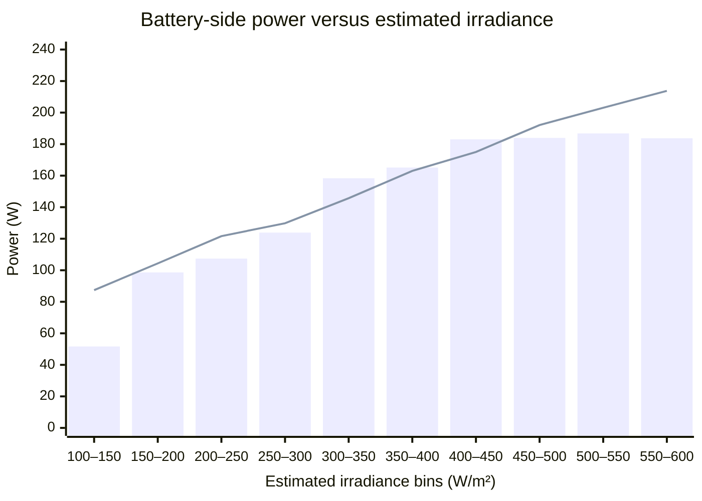

# Project HELIOS Experimental Analysis

**Tennessee Tech University · ECE Capstone Team 6 · LaniEV retrofit**

## Introduction

Project HELIOS is a Tennessee Tech capstone project with LaniEV to retrofit an electric Club Car with a solar roof and a lithium iron phosphate battery. This report examines whether the installation manual gives someone unfamiliar with the kit enough information to complete the retrofit and what the team can verify about the resulting cart.

The report covers the installation manual trials, changes documented in the manual, the roof swap and its effect on weight, and fixed-panel charging tests on the team's Club Car. The fixed-panel measurements provide the baseline for evaluating the solar-tracking concept.

## 1. Installation manual validation

**Purpose and expected result.** Demonstrate that a person who did not write the manual can complete the documented steps with the correct hardware, orientation, routing, and connections. The expected outcome was independent completion with clear component identification and minimal intervention.

Parker Branson timed two roof installation trials and two battery wiring trials. He recorded skipped or incorrect steps and questions the installers asked. Outside participants installed the frame, gaskets, front and rear plates, and panel and hooked up the solar leads. A manual author and an outside participant each attempted the battery wiring procedure. George Vaporis oversaw the battery connection testing.

| Section | Trial | Tester(s) | Time | Skipped or incorrect steps | Questions |
|---|---:|---|---:|---:|---:|
| Solar roof | 1 | Two outside non-authors | 31 min 24 s | 4 | 3 |
| Solar roof | 2 | Two outside non-authors | 30 min 59 s | 3 | 3 |
| Battery wiring | 1 | One author | 4 min 15 s | 3 | 1 |
| Battery wiring | 2 | One outside non-author | 6 min 30 s | 2 | 2 |

| Section | Trials | Mean time | Sample SD | Range | Mean errors | Mean questions |
|---|---:|---:|---:|---|---:|---:|
| Solar roof | 2 | 31 min 11.5 s | 17.7 s | 30:59–31:24 | 3.5 | 3.0 |
| Battery wiring | 2 | 5 min 22.5 s | 95.5 s | 4:15–6:30 | 2.5 | 1.5 |

The roof trials revealed ambiguity about bolt locations, PV connector polarity, gasket placement, washer placement, front-plate orientation, how the panel sits on the frame, and wire routing. The battery trials both recorded omitted connections and questions about wire identity or placement. The four trials each recorded at least two skipped or incorrect steps.

### Confirmation notes and what the manual records

Parker's validation log records the issues the testers encountered. The [Overleaf manual](https://www.overleaf.com/project/6adcf6f2e207c9e858e8b3a7) preserves the original C01–C10 list in `sections/12_confirmation_items.tex`. The inclusion of that file is commented out in `main.tex`. The table traces the original questions to the procedure and the trial observations. [Dated GitHub manual editions](https://github.com/alectsnodgrass/Project-HELIOS/tree/main_Snodgrass/2.%20Documentation/5.%20Installation%20Manual).

| ID | Original confirmation item | What the manual and trials document |
|---|---|---|
| C01 | Vehicle variant, service manual, and kit version | The cover identifies a 2020 Club Car Precedent electric golf car, matching Parker's trial record. |
| C02 | Tools, mounting hardware, quantities, and torque | Parker's trial record lists 8 mm and 10 mm sockets, a 1 in spade bit, and a T18 star bit. The tools section lists a conditional 5/8 in socket for existing battery hold-down nuts. The mounting section shows front and rear hardware in photos. |
| C03 | Isolation, existing battery removal, and controller discharge delay | The manual gives a negative-first instruction tied to the vehicle service procedure and labels its 90-second delay provisional. The cart arrived without its lead-acid bank, so the team encountered the manual's missing-batteries case. |
| C04 | Rear wheel-well openings and cable protection | The routing section shows a wheel-well opening and describes routing from each rear canopy support into the battery compartment through a protective grommet. The 1–1.5 in range is marked provisional. |
| C05 | Rear support fit and alignment | Parker recorded that the rear supports spread during fitting and the frame aligned with the original supports. The frame section tells installers to check that the holes line up before inserting the fasteners. |
| C06 | Gasket fit, cover screws, and tightening | The panel section places two gasket pieces at the front and rear contact surfaces and gives an approximate 39.5 in length. Parker recorded four cover screws per end. The panel section places the gasket before the panel. Parker's trial log records a proposed change to that order. |
| C07 | Compartment trimming and battery restraint | The battery section includes a before photo and two photos of trimmed plastic. It shows the replacement replacement battery mounting procedure with brackets. |
| C08 | Old port disposition and new port location and routing | The battery section locates the new port on the driver's side and routes its cable through the existing port opening. |
| C09 | Charger identification, wiring diagram, and connection details | The electrical section describes the port-to-charger and charger-to-battery connections for wall charging. The panel section identifies the positive and negative leads at the rear mount and refers to a separate wiring diagram. |
| C10 | Pre-power, charging, fault, and operating checks | The manual lists mechanical and cable inspections, describes monitoring charge with Olelon Connect, and provides a handover record. These are documented procedures. The four timed trials exercised the roof and battery connection portions of the manual. |

Parker's revision log also records problems with washer placement, front cover orientation, panel seating, and cable routing. It lists photos and clearer labels as proposed changes. The panel section in Overleaf now shows the gasket and cover in photos and gives separate steps for front and rear cover placement and PV lead identification.

## 2. Solar roof installation and mass change

**Purpose and expected result.** Document the roof conversion and quantify its impact on vehicle weight. The added panel, frame, gasket and hardware were expected to increase roof weight.

| Installation stage | Evidence recorded |
|---|---|
| Remove and weigh OEM roof | 19 lb |
| Fit the frame to the original supports | Frame alignment and rear support spread documented in C05 |
| Fit panel, gaskets and end plates | Trials identified sequencing, washer placement and front-plate orientation issues |
| Route and connect panel wiring | Trials identified routing and polarity-label issues |
| Weigh complete solar roof assembly | 50 lb, including frame, gasket, panel and hardware |

The assembly added **31 lb**. The scale displayed increments of 1 lb. If each reading was rounded to the nearest pound, the worst-case combined rounding contribution to the difference is ±1 lb. The scale's calibration accuracy is unknown.

The original lead-acid bank was missing when the team received the vehicle. Parker Branson's experimental analysis write-up uses approximately 372 lb for six 8 V Werker SLIGC8-875 batteries based on the Batteries Plus reference (about 62 lb each). Parker reports a replacement pack weight of 108.03 lb. The resulting battery-only comparison is approximately 264 lb lighter. Applying those component differences to the source's 909 lb stock reference gives an estimated 676 lb, or approximately 680 lb, for the retrofit and a net reduction of approximately 230 lb. Both whole-cart weights are estimates based on the stock reference and component weights.

## 3. Electrical design and measurement point

The fixed-panel charging test measured the DC output between the MPPT controller and the battery. The solar subsystem drawing shows the charging path used to locate that measurement. The battery and power management detailed designs document the associated harness and charging interfaces.

*Figure 1. Solar subsystem design schematic.*

## 4. Solar charging baseline

**Purpose and expected result.** Establish fixed-panel battery-side charging performance before evaluating the parked solar-tracking design. Power was expected to vary with sunlight and system conditions. 

**Procedure.** The team placed the fixed-panel cart outdoors with the panel exposed to sunlight. Using items 1–3 and 7–10, it recorded time of day, DC voltage and current at the controller-to-battery connection with a Fluke 15B+, plane-of-panel illuminance with a URCERI MT-912, and displayed battery SOC. The illuminance sensor was held parallel to the panel and kept unobstructed. Battery-side power was calculated as $P=VI$. The workbook illuminance entries are in kilolux. The estimated irradiance is $G_{est}=1000L_{klx}/122$ in W/m², using an assumed daylight efficacy of 122 lm/W. Energy was integrated by the trapezoidal rule with the recorded time differences in hours.

**Sampling.** The existing workbook records samples approximately every **25 minutes**. The professor's experimental-analysis guidance recommends **one-minute sampling or faster**. Each matched window has 12 measured samples spanning 11 intervals. Power between readings is estimated by interpolation for integration. Clouds and brief charging transients may be missed. There are no one-minute measurements in these runs.

*Figure 2. MPPT-to-battery measurement location.*

### Results for matched windows

| Date in 2026 | Recorded window | Mean sampled power (W) | Highest sample (W) | Mean estimated irradiance (W/m²) | Energy (Wh) | Displayed SOC | Estimated insolation (kWh/m²) | Normalized yield (Wh per equivalent peak-sun hour) |
|---|---|---:|---:|---:|---:|---|---:|---:|
| Oct. 9 | 10:45–15:20 | 145.32 | 202.37 | 330.9 | 681.9 | 6% → 16% | 1.564 | 436.1 |
| Nov. 3 | 09:20–13:55 | 138.48 | 192.75 | 350.8 | 648.8 | 17% → 24% | 1.641 | 395.4 |
| Nov. 7 | 08:35–13:10 | 181.99 | 205.35 | 402.7 | 851.7 | 24% → 35% | 1.872 | 455.0 |
| Nov. 8 | 09:15–13:50 | 165.27 | 179.62 | 424.7 | 763.2 | 34% → 45% | 1.977 | 386.0 |
| Nov. 15 | 08:35–13:10 | 179.10 | 202.13 | 360.5 | 832.3 | 45% → 57% | 1.682 | 494.8 |

Energy averaged **755.6 Wh per 4 h 35 min window** with a sample SD of **89.5 Wh** across the five dates. The Nov. 8 workbook integration gives 763.249 Wh and rounds to 763.2 Wh, matching the five-run figure. The earlier five-run text gives 763.3 Wh. The full Nov. 8 record includes the 14:15 observation (53.2 V, 2.14 A, 40.6 klx, 46% SOC). Over that 5 h record, the reported values are 161.31 W mean, 179.62 W peak, 417.6 W/m² mean estimated irradiance, and 814.1 Wh estimated energy. It remains in the workbook and four-run figures. [Charging workbook](https://github.com/alectsnodgrass/Project-HELIOS/blob/main_Snodgrass/2.%20Documentation/2.%20Electrical/Charging%20Analysis/Charging%20Analysis%20Data.xlsx) · [Four-run analysis](https://github.com/alectsnodgrass/Project-HELIOS/blob/main_Snodgrass/2.%20Documentation/2.%20Electrical/Charging%20Analysis/Charging_Analysis.md) · [Five-run charging analysis](https://github.com/alectsnodgrass/Project-HELIOS/blob/main_Snodgrass/2.%20Documentation/Experimental%20Analysis/Experimental_Analysis.md).

*Figure 3. Power versus time, five matched-duration runs.*

*Figure 4. Mean power by date, five matched-duration runs.*

*Figure 5. Integrated energy by date, five matched-duration runs.*

*Figure 6. Displayed battery SOC versus elapsed time, five matched-duration runs.*

Original four-run charging figures

The original figures include the complete five-hour November 8 run. Their links resolve to the PNG files in the charging-analysis directory.

*Figure 7. Power versus time, original four-run analysis.*

*Figure 8. Mean power by date, original four-run analysis.*

*Figure 9. Energy by date, original four-run analysis.*

*Figure 10. Displayed battery percentage versus time, original four-run analysis.*

### Irradiance normalization and residuals

Estimated insolation integrates $G_{est}$ over the same window as the power. Dividing insolation by 1 kW/m² yields equivalent peak-sun hours. The normalized yield divides battery-side Wh by those hours. This comparison inherits uncertainty from the uncalibrated lux conversion and uses the recorded window only.

An ordinary least-squares fit to the 60 matched-window workbook samples gives $P_{fit}=54.68+0.28710G_{est}$, with $P$ in watts and $G_{est}$ in W/m². The fit has $R^2=0.686$ and an in-sample residual RMSE of 18.88 W. Residuals are observed power minus fitted power. The nonzero intercept is descriptive over the sampled range of 114–554 W/m². It has no demonstrated predictive value at zero irradiance.

*Figure 11. Bars show the mean measured power in each 50 W/m² bin. The line evaluates the 60-sample fit at each bin's mean irradiance. Bin counts from left to right are 1, 3, 2, 6, 8, 11, 18, 5, 5 and 1.*

| Date | Mean residual (W) | Range of residuals (W) |
|---|---:|---:|
| Oct. 9 | −4.36 | −15.85 to +9.50 |
| Nov. 3 | −16.92 | −35.75 to +7.15 |
| Nov. 7 | +11.71 | −20.12 to +31.78 |
| Nov. 8 | −11.34 | −30.07 to +22.46 |
| Nov. 15 | +20.91 | +8.29 to +34.51 |

The shifts by date show that estimated irradiance alone leaves systematic differences between runs. Starting SOC, panel temperature, exposure and operating conditions vary across dates. The workbook's calculated efficiency column also depends on the irradiance estimate and does not establish measured panel efficiency.  The five-run SD captures between-window variation only.

## 5. Driving discharge testing

George Vaporis and Nathan Galloway worked together on charging and discharge testing. George designed and ran the driving discharge experiment and took most of the measurements. Nathan worked on the discharge data and analysis.

## 6. Design traceability and overall findings

| Detailed design | Experimental connection |
|---|---|
| [Snodgrass · structural frame](https://github.com/alectsnodgrass/Project-HELIOS/blob/main_Snodgrass/1.%20Reports/3A.%20Snodgrass_Detailed%20Design.md) | Roof mounting, alignment, assembly and mass comparison. Structural load/deflection analysis remains design evidence. |
| [Vaporis · power management](https://github.com/alectsnodgrass/Project-HELIOS/blob/main_Snodgrass/1.%20Reports/3B.%20Vaporis_Detailed%20Design.md) | MPPT, AC charger and DC–DC interfaces. The fixed-panel test measured MPPT output. |
| [Paul · battery installation](https://github.com/alectsnodgrass/Project-HELIOS/blob/main_Snodgrass/1.%20Reports/3C.%20Paul_Detailed%20Design.md) | Battery mounting, harness interfaces and wiring identification. Connection trials motivated labeling and a wiring diagram. |
| [Galloway · solar panel](https://github.com/alectsnodgrass/Project-HELIOS/blob/main_Snodgrass/1.%20Reports/3D.%20Galloway_Detailed%20Design.md) | PV system and wiring schematic. The fixed-panel test measured baseline charging performance. |
| [Branson · cart preparation](https://github.com/alectsnodgrass/Project-HELIOS/blob/main_Snodgrass/1.%20Reports/3E.%20Branson_Detailed%20Design.md) | OEM removal and preparation. Roof/kit wiring procedures exercised and revision items recorded. |
 
The experiments quantified the roof assembly weight increase and fixed-panel charge performance on one Club Car. The manual trials identified specific difficulties with the roof assembly and battery wiring. The charging measurements quantify battery-side energy delivered by the fixed panel over the five recorded windows. [Conceptual design](https://github.com/alectsnodgrass/Project-HELIOS/blob/main_Snodgrass/1.%20Reports/2.%20Conceptual%20Design.md) · [Experimental analysis specifications](https://github.com/alectsnodgrass/Project-HELIOS/blob/main_Snodgrass/1.%20Reports/5.%20Experimental%20Analysis%20Specifications.md).

## 7. Component inventory

The inventory below covers the equipment identified in the installation trials, roof weighing, and fixed-panel charging tests.

| Item # | Description | Quantity | Vendor/source | Order # / ID | Cost | Storage location | Date acquired | Condition | Notes |
|---:|---|---|---|---|---|---|---|---|---|
| 1 | 2020 Club Car Precedent electric | 1 | Tennessee Tech University | — | — | — | — | — | Cart under test |
| 2 | Roof frame | 1 assembly | LaniEV | — | — | — | — | — | Roof trials and fixed-panel test |
| 3 | Roof solar panel | 1 | LaniEV | — | — | — | — | — | Roof trials and fixed-panel test |
| 4 | Gasket material and front/rear plates | 1 gasket set, 2 plates | — | — | — | — | — | — | Roof trials |
| 5 | Roof bolts, washers and cover screws | — | — | — | — | — | — | — | Eight cover screws recorded |
| 6 | Removed OEM roof | 1 | Original Club Car | — | — | — | — | — | Weighed after removal |
| 7 | LiFePO₄ battery system and kit harness | 1 system | LaniEV kit | — | — | — | — | — | Battery wiring and charging baseline |
| 8 | MPPT charge controller | 1 | LaniEV | — | — | — | — | — | Charging baseline |
| 9 | Digital multimeter | 1 | Fluke | 15B+ model | — | — | — | — | Battery-side voltage and current |
| 10 | Illuminance meter | 1 | URCERI | MT-912 model | — | — | — | — | Plane-of-panel illuminance |
| 11 | AC charger and charging port, DC–DC converter, fuses and breakers | — | — | — | — | — | — | — | Identified in the installation and electrical design documentation |
| 12 | Scale | 1 | — | — | — | — | — | — | 1 lb resolution recorded |

## 8. Individual statements of contributions

**Alec Snodgrass.** Alec directed the team's work and reviewed and revised the material each team member submitted. He focused especially on the installation manual, working through gaps and inconsistencies in the procedure and revising the instructions. He also brought the team's test records, measurements, and analyses together in the experimental report.

**Parker Branson.** Parker timed the manual trials and recorded participants' questions and the steps they skipped or performed incorrectly. He used those observations to build the revision log and document confirmation items. He also documented the roof installation, weighed the removed roof and the new solar assembly, and compared the original and retrofit configurations using a reference weight for the missing lead-acid bank.

**George Vaporis.** George led development of the solar-tracking concept. He helped Parker validate the manual and oversaw the battery connection testing. He shared charging data collection with Nathan and designed the driving discharge experiment, taking most of the measurements.

**Nathan Galloway.** Nathan shared charging data collection with George and worked on the Charging and Discharging analysis data sheets, and reports.
