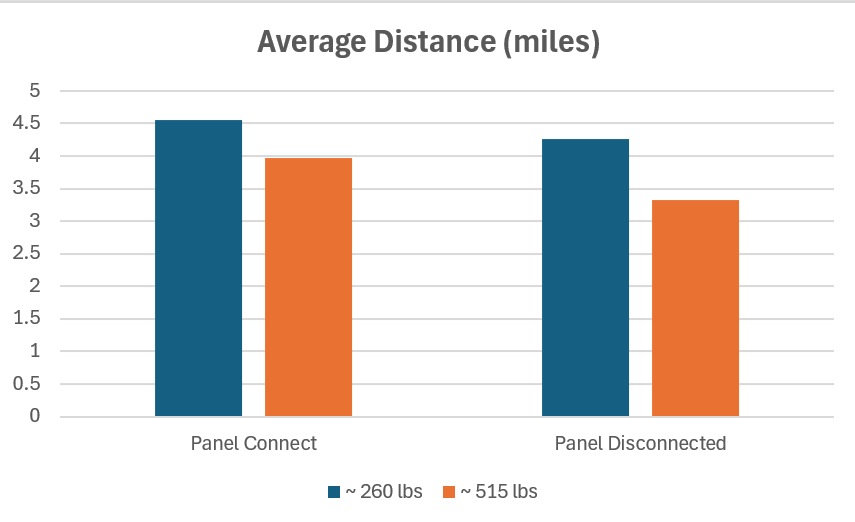
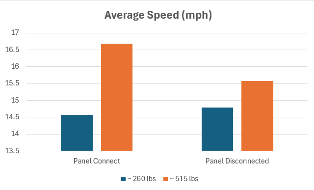
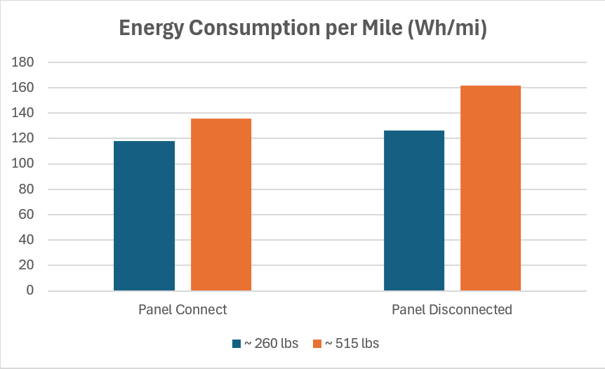
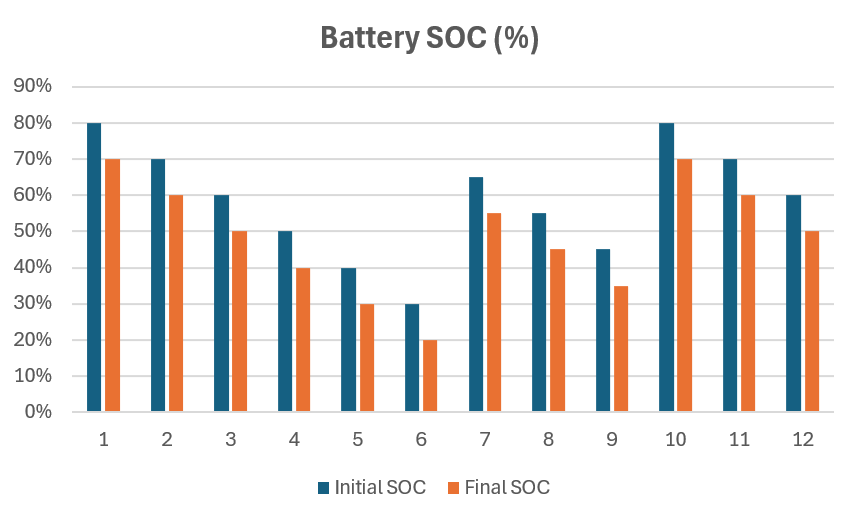

# Discharging Analysis

## 1. Purpose and Justification

The purpose of this experiment was to evaluate how the golf cart’s battery charge decreased during driving and how its performance varied with different weighted loads and solar panel connections. The team compared the distance traveled and estimated net battery energy consumption for two different loads, both with the original fixed solar panel connected and disconnected. This experiment complements the Charging Analysis, which measured power delivered to the battery from the solar charging system while the cart was parked.

## 2. Detailed Procedure

### 2.1 Equipment and Test Configuration

| Equipment   | Specification                                   |
|-------------|-------------------------------------------------|
| Golf cart   | Lani EV golf cart                               |
| Battery     | lithium-ion (LiFePO₄), 51.2 V, 105 Ah, 5,376 Wh |
| Solar Panel | Original fixed solar panel                      |
| Test route  | Approximately 616 yards per lap (0.35 mi)       |

The two approximate total load conditions were 260 lb and 515 lb. The reported top speed was 21 mph with the smaller load and 18 mph with the larger load. These were reported maximum speeds, not separately controlled target speeds for every run.

### 2.2 Testing Procedure

Testing was conducted on campus on November 21 and 22, 2026. The team selected an approximately 616-yard loop located around the tennis courts near the intersection of Stadium Drive and University Drive. The golf cart was driven along the same route under different load conditions, with the solar panel either connected or disconnected. For each run, the team recorded the starting battery state of charge (SOC) using the battery percentage indicator provided by Lani EV, the driving time using a stopwatch, the number of laps completed, and the ending battery SOC. Each run continued until the battery SOC decreased by 10 percentage points.

The smaller load runs were recorded on November 21, and the larger load runs were recorded on November 22, giving a total of 12 runs.

| Load                 | Solar panel  | Number of runs |
|----------------------|--------------|----------------|
| Approximately 260 lb | Connected    | 3              |
| Approximately 260 lb | Disconnected | 3              |
| Approximately 515 lb | Connected    | 3              |
| Approximately 515 lb | Disconnected | 3              |

### 2.3 Calculations

Distance traveled. With 616 yards per lap, 1,760 yards per mile:

$$d=N_{\text{laps}}\left(\frac{616}{1760}\right)=0.35N_{\text{laps}}$$

where $d$ is distance in miles.

Average driving speed. Using elapsed driving time $t$ in minutes:

$$v_{\text{avg}}=\frac{d}{t/60}$$

Estimated net battery energy decrease. The battery has a nominal capacity of 5,376 Wh. The estimated decrease in stored battery energy is:

$$E=5376\left(\frac{SOC_{\text{initial}}-SOC_{\text{final}}}{100}\right)$$

Estimated net battery energy consumption per mile.

$$\frac{\text{Wh}}{\text{mi}}=\frac{E}{d}$$

The energy figures are estimates, not direct electrical measurements. They assume the displayed SOC percentage is proportional to the battery’s nominal stored energy. This calculation shows the net decrease in battery energy, not total energy used by the motor; solar contribution was not separately measured during these runs.

## 3. Expected Results

The team expected the cart to travel a shorter distance for the same battery SOC decrease with a larger load because more energy is required to move the additional weight. The team also expected the solar connected runs to show greater distance per 10 percentage point SOC decrease, since the solar charging system could supply part of the energy demand while driving. Average driving speed was expected to vary between runs.

## 4. Actual Results

Twelve runs were recorded. Table 1 shows the individual measurements and the values calculated from the approximate route, elapsed time, and nominal battery capacity.

**Table 1. Recorded driving tests and calculated discharge metrics**

| Run | Date   | Load    | Solar Panel  | Initial SOC | Final SOC | Time (min) | Laps | Distance (mi) | Avg speed (mph) | Est net Wh/mi |
|-----|--------|---------|--------------|-------------|-----------|------------|------|---------------|-----------------|----------------|
| 1   | Nov 21 | ~260 lb | Connected    | 80%         | 70%       | 19:13      | 13   | 4.550         | 14.21           | 118.2          |
| 2   | Nov 21 | ~260 lb | Disconnected | 70%         | 60%       | 18:31      | 12.5 | 4.375         | 14.18           | 122.9          |
| 3   | Nov 21 | ~260 lb | Connected    | 60%         | 50%       | 18:36      | 13   | 4.550         | 14.68           | 118.2          |
| 4   | Nov 21 | ~260 lb | Connected    | 50%         | 40%       | 18:26      | 13   | 4.550         | 14.81           | 118.2          |
| 5   | Nov 21 | ~260 lb | Disconnected | 40%         | 30%       | 16:38      | 12   | 4.200         | 15.15           | 128.0          |
| 6   | Nov 21 | ~260 lb | Disconnected | 30%         | 20%       | 16:45      | 12   | 4.200         | 15.04           | 128.0          |
| 7   | Nov 22 | ~515 lb | Disconnected | 65%         | 55%       | 12:38      | 9    | 3.150         | 14.96           | 170.7          |
| 8   | Nov 22 | ~515 lb | Disconnected | 55%         | 45%       | 12:15      | 9.5  | 3.325         | 16.29           | 161.7          |
| 9   | Nov 22 | ~515 lb | Disconnected | 45%         | 35%       | 13:34      | 10   | 3.500         | 15.48           | 153.6          |
| 10  | Nov 22 | ~515 lb | Connected    | 80%         | 70%       | 13:50      | 11   | 3.850         | 16.70           | 139.6          |
| 11  | Nov 22 | ~515 lb | Connected    | 70%         | 60%       | 14:25      | 11.5 | 4.025         | 16.75           | 133.6          |
| 12  | Nov 22 | ~515 lb | Connected    | 60%         | 50%       | 14:33      | 11.5 | 4.025         | 16.60           | 133.6          |

For each condition, the team calculated the average results from the three runs.

### 4.1 Average Distance

**Figure 1. Average distance traveled for a 10 percentage point SOC decrease under each load and solar connection condition.**

With the smaller load, the cart traveled an average of 4.55 mi with solar connected and 4.26 mi with solar disconnected. With the larger load, the averages were 3.97 mi and 3.33 mi, respectively. The solar connected runs covered approximately 6.8% more distance with the smaller load and 19.3% more distance with the larger load for the same recorded SOC decrease.

### 4.2 Average Speed

**Figure 2. Average driving speed calculated from the approximate distance and recorded driving time for each run.**

Average driving speed ranged from 14.56 to 16.68 mph across the four conditions. These values describe the speeds averaged over complete runs and are not the same as the reported top speeds of 21 mph and 18 mph.

### 4.3 Estimated Energy Consumption per Mile

**Figure 3. Estimated net battery energy decrease per mile for each test condition, calculated using a nominal 537.6 Wh decrease per 10 percentage point SOC change.**

The smaller load runs averaged 118.2 Wh/mi with solar connected and 126.3 Wh/mi with solar disconnected. The larger load runs averaged 135.6 Wh/mi with solar connected and 162.0 Wh/mi with solar disconnected. Thus, the connected panel conditions showed lower estimated net battery energy decrease per mile under both tested loads.

### 4.4 Battery State of Charge

**Figure 4. Recorded initial and final battery SOC for each of the 12 driving runs.**

Each run was recorded over a 10 percentage point SOC drop. This allows a consistent comparison of distance traveled for the same indicated decrease in charge. The different starting SOC values are also important when interpreting differences between runs because the battery’s SOC indication does not necessarily correspond perfectly to the same amount of usable energy under all operating conditions.

## 5. Interpretation and Conclusions

The discharge tests showed that the golf cart generally traveled farther with the smaller load and when the original solar panel was connected. Over the same indicated 10 percentage point battery SOC decrease, the average travel distance ranged from approximately 3.33 to 4.55 miles. Using the battery’s nominal 5,376 Wh capacity, the estimated net battery energy decrease ranged from 118.2 to 162.0 Wh/mi across the four test conditions. These results suggest that the load and solar panel connection were associated with differences in driving range and net battery energy consumption. However, the recorded differences should not be attributed solely to the solar panel or payload. The two loads were tested on separate days, starting SOC levels varied, and driving speeds were not independently controlled. Because the team did not record separate solar voltage/current during driving, the estimated Wh/mi values represent battery energy decrease rather than directly measured motor energy consumption. Standby discharge while parked was not measured in the available data.,The earlier Charging Analysis estimated approximately 648.8–851.7 Wh delivered toward the battery during each 4-hour-and-35-minute parked test, while this discharge analysis estimates a 537.6 Wh net battery energy decrease per driving run.

Overall, the experiment provided a baseline comparison of the golf cart’s discharge performance across two loads and solar-panel connection conditions. The collected results can be used alongside the charging analysis when evaluating the golf cart’s energy performance and potential benefit of the proposed solar-tracking design.