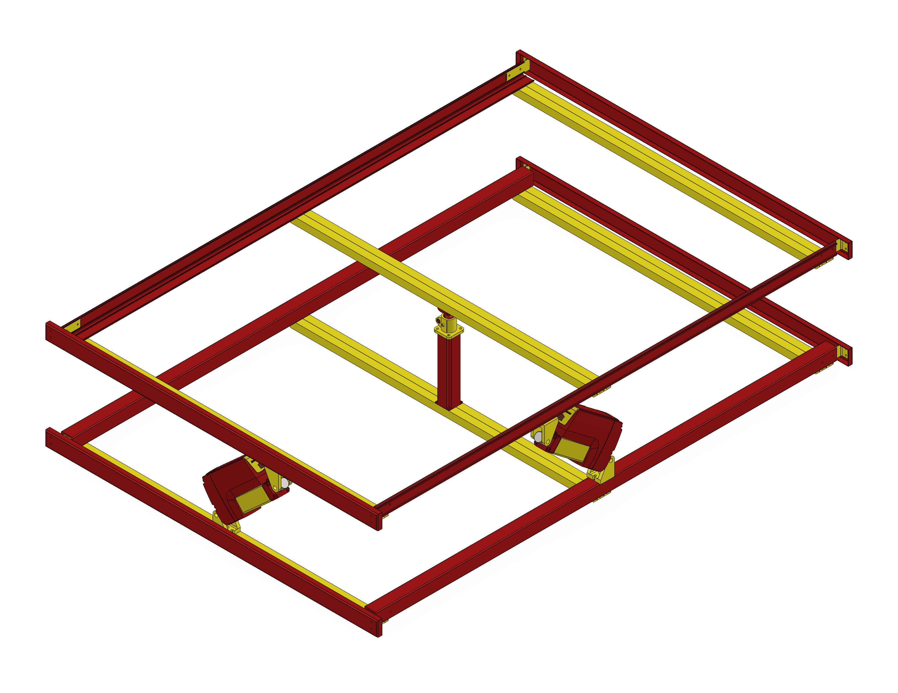
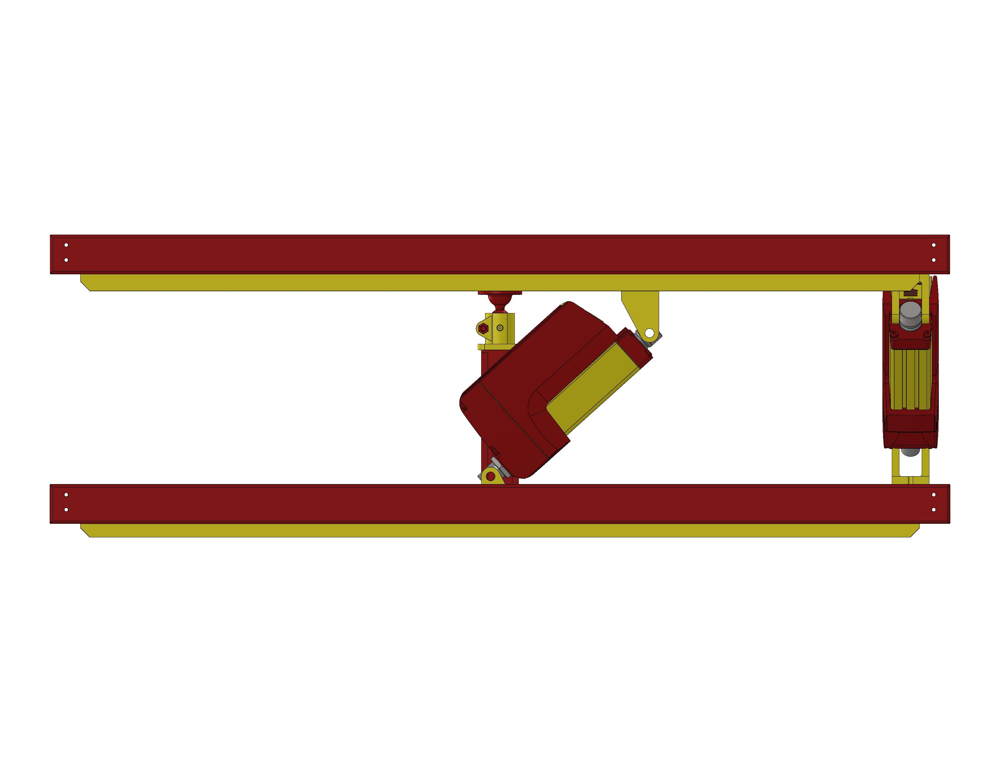

# HELIOS solar-tracking frame CAD

Poster images, browser-viewable meshes, and editable SolidWorks source for the Lani EV capstone project.

## Poster images

Both PNGs are 3300 × 2550 pixels with 300 DPI metadata and an alpha channel. The solar panel itself and the cart are absent from these frame assembly images.

*Solar-tracking frame concept showing the upper panel frame, lower support frame, two linear actuators, and central ball-joint support.*

*Front view of the actuator and central-support arrangement.*

## Interactive GitHub previews

Open these STL links on GitHub to rotate and zoom the models:

- [Complete assembly — lightweight preview](GitHub%20Viewable/Frame%20Assemblies/Composite-preview.stl)
- [Panel frame](GitHub%20Viewable/Frame%20Assemblies/Panel_Frame.STL)
- [Base frame](GitHub%20Viewable/Frame%20Assemblies/Base_Frame.STL)
- [Linear actuator](GitHub%20Viewable/Actuator/Linear_Actuator.STL)
- [Ball joint](GitHub%20Viewable/Ball%20Joint/Ball_Joint.STL)
- [Individual frame parts](GitHub%20Viewable/Frame%20Parts)

The complete-assembly preview was exported directly from SolidWorks using binary STL, millimeters, coarse resolution, and all assembly components in one file. It is approximately 4.94 MB. The original full-detail `Composite.STL` is preserved alongside it at 13.74 MB, for download rather than GitHub preview.

GitHub's STL viewer has a 10 MB limit. STL preserves geometry but does not preserve the SolidWorks appearances, mates, or editable features. Use the PNGs for the red/gold presentation colors. STEP files in the cart folder are downloads, not GitHub 3D previews. [GitHub file-viewer documentation](https://docs.github.com/en/repositories/working-with-files/using-files/working-with-non-code-files).

## Editable source

The `SolidWorks Accessable` folder retains the user's existing folder name and subfolder organization. Start with `SolidWorks Accessable/Frame Assemblies/Composite.SLDASM` in SolidWorks 2026. Keep all source subfolders together. This is a copy of the updated source folders, not a SolidWorks Pack and Go export; reopening the copied assembly on another computer has not been tested.

## Adding to the repository

Extract the bundle and place its contents in the repository's CAD Models directory, keeping the relative folder layout. If the updated source and STL folders are already in the repository, only add this README, the `images` folder, and `GitHub Viewable/Frame Assemblies/Composite-preview.stl`. Commit and push those additions to make the previews available online. Uploading the ZIP alone will not expose the STL previews.

## Verification

The PNGs were visually checked for complete framing. All supplied STL files and the new preview passed binary record-length and finite-coordinate checks. These checks verify file structure, not watertightness, manufacturability, motion, or structural strength. The original native files and full-detail exports were not modified.
